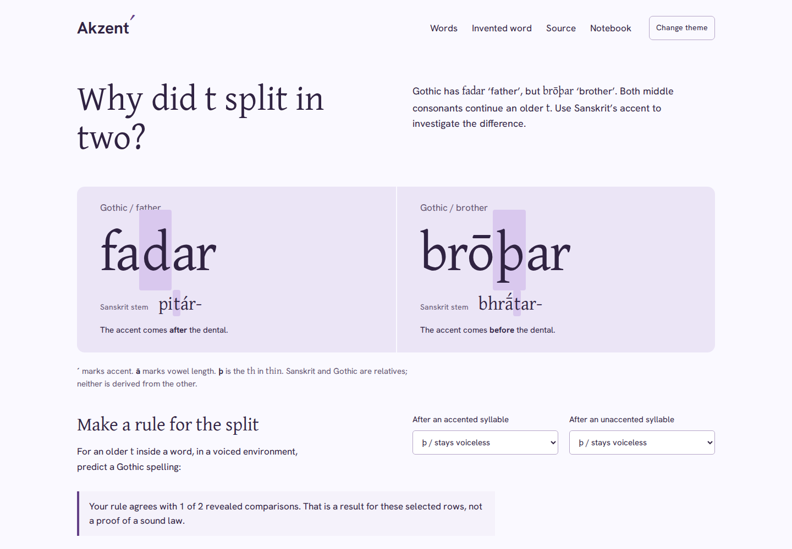
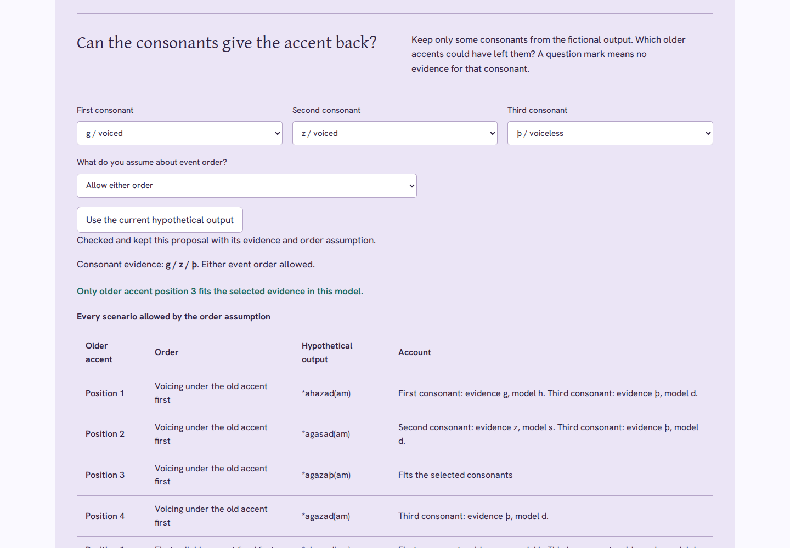
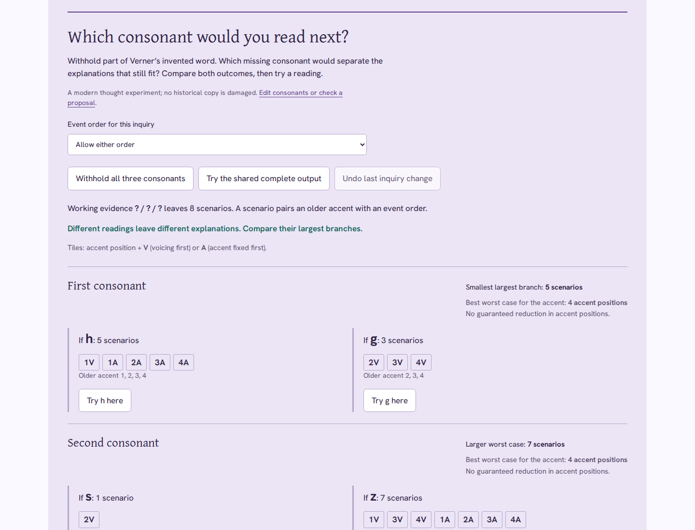

# Akzent

**Make a sound rule. Risk a prediction. Keep the word that resists it.**

[Live workshop](https://antonsoo.github.io/akzent/) · [Audit and reproducible investigations](docs/audit.md)

[](LICENSE)



Gothic **fadar** ‘father’ has **d** where **brōþar** ‘brother’ has **þ**.
Both consonants continue an older _t_. Karl Verner's explanation connects
that split with an earlier accent. Akzent turns the comparison into something
a learner can operate: propose a rule, keep a prediction before revealing
another word, inspect the disagreements, and read the original argument.

The second investigation reworks Verner's explicitly invented **\*akasatam**.
Move one accent through four syllables and watch three consonants respond.
Then move the accent _before_ the voicing test: the four outcomes collapse.
Work backwards from incomplete consonant evidence. A compatible accent may
be unique, ambiguous, or impossible under the stated assumptions.



## Which consonant would you read next?

The local edition adds an inquiry to the existing invented-word workshop.
Withhold consonants, compare the explanations each possible reading would
leave, then try a branch. With either event order allowed, the first consonant
splits eight scenarios into five versus three. The other consonants split them
one versus seven. The accent-position goal gives a different result: all three tests tie at a
worst case of four positions. No next reading guarantees a narrower accent
answer. Both rankings stay visible; these counts are not probabilities.

A complete **h / z / d** still leaves five scenarios spanning all four older
accents. No missing letter can restore a distinction already erased before
voicing. The reading route stops at that boundary, keeping the unresolved
explanations visible. Checked proposals retain their original inputs. Undo restores the inputs before
your last inquiry change in this visit.



Choose **Next reading** in the local app. Save exact reading-plan CSV, editable
JSON or an illustrated reading with seven complete source pages. The reading
now also embeds native JSON and CSV downloads; it can recover editable work
without a connection or scripts. Its route and output groups expand for print.

[Operate the inquiry and inspect its boundaries](docs/inquiry-review.md) ·
[Adversarial audit and transfer corrections](docs/inquiry-audit.md) ·
[Actual downloaded plan](examples/inquiry/reading-plan.csv) ·
[Illustrated PDF](examples/inquiry/reading-plan.pdf).
The audit distinguishes local verification from public delivery; see its
publication record for the reviewed edition.

## Try it

With Node **24 or later**, from this checkout:

```sh
npm ci
npm run check
npm run dev
```

Open **http://127.0.0.1:4392/akzent/**. If that port is occupied, use
`npm run dev -- --port 4397` and open port 4397 instead. For a first investigation:
1. Change “After an unaccented syllable” to **d / becomes voiced**.
2. Choose **under / within**, then **Keep prediction & reveal**.
3. Try **which of two** with the same rule. Keep the mismatch; inspect p. 119.
4. Move the accent to the third syllable of the invented word, then switch
   the event order. Explain what information was lost.
5. At “Can the consonants give the accent back?”, choose **h / z / d**.
   Compare the conventional order with **Allow either order**. How many older
   accents fit? Try **g / z / þ**, then **h / s / ?**.
6. Check an accent proposal, cite a reading, write an explanation, and save an
   illustrated reading. Changing evidence keeps the checked proposal intact.

The production command is **`npm run build`**, producing **`dist/`** with
base **`/akzent/`**. Run `npm run preview` for
**http://127.0.0.1:4391/akzent/**. Development uses a separate origin so an
installed offline edition cannot conceal edits.

## What the learner changes

| Investigation      | Action                                                         | Observable consequence                                            |
| ------------------ | -------------------------------------------------------------- | ----------------------------------------------------------------- |
| A dental split     | Choose what follows accented and unaccented syllables          | Predictions beside the observed Gothic spellings                  |
| Unseen comparison  | Keep a prediction before revealing a word                      | A fixed record with its own rule; later edits do not rewrite it   |
| Resistant evidence | Inspect katará- / hvaþar and páti- / -fadi-                    | Two disagreements remain in the simple comparison                 |
| An invented word   | Move the older accent through *akasatam                        | Four endpoints transcribed from Verner's p. 115                   |
| Event order        | Fix initial accent before or after voicing                     | An early move erases the older contrast before voicing can use it |
| Inverse accent     | Withhold consonants and choose an event-order assumption       | All allowed scenarios, with a reason for each conflict            |
| Checked proposal   | Submit one older accent, then change the evidence              | The earlier account keeps its own evidence and assumptions        |
| Environment        | Change initial position, voiced neighbors, or preceding accent | Accent alone does not license voicing                             |
| Close reading      | Select German phrases and cite the readings                    | Contextual English notes and references in the notebook           |

The table contains eight selected rows. The conventional accent rule agrees
with six. That count belongs to this deliberately selected worksheet, not
to historical linguistics as a whole. The two disagreements come from
Verner's own list; the application retains them.

## Read the evidence

The primary source is Karl Verner,
[_Eine ausnahme der ersten lautverschiebung_](https://archive.org/details/india.history.resource.77512),
_Zeitschrift für vergleichende Sprachforschung_ 23 (1877), pp. 97–130.
The article is signed Copenhagen, July 1875; bibliographies use varying
publication dates. This edition identifies it by the volume's date and pages.

Twelve complete page images are retained. Six short German readings have
new English translations and contextual phrase notes. The viewer verifies
each image's byte length and SHA-256 before displaying it. At full size,
its actual pixels are available in a keyboard-pannable viewport.
Superseded requests cannot replace the selected page.

The readings are normalized excerpts, not diplomatic transcriptions:
the dental type is normalized to þ, Sanskrit uses modern IAST, and the
fictional-word excerpt marks omitted phonetic notation with an ellipsis.
The complete images preserve the original context.

The [University of Texas LRC's 1967 translation](https://lrc.la.utexas.edu/books/reader/11-k-verner)
was consulted for comparison. Its English is not reproduced here.
See the [source concordance](docs/model-and-sources.md),
[scan provenance](public/sources/provenance.json),
[retained-file manifest](src/asset-manifest.json), and
[source notice](public/sources/NOTICE.txt).

## A notebook that leaves the page

| Download           | Contents                                                                                                                                                    |
| ------------------ | ----------------------------------------------------------------------------------------------------------------------------------------------------------- |
| Editable JSON      | Rule, selected/revealed words, fixed predictions, citations, explanation, accent, event order, environment, draft and checked inverse account; reopens here |
| Illustrated HTML   | The same notebook, all investigations, readings, seven complete source pages, embedded fonts and licenses; opens offline and prints through the browser     |
| CSV                | Separate current-rule and fixed-prediction rows, with observations, source pages, and agreement                                                             |
| Accent-account CSV | Every allowed scenario for the current evidence and the last checked proposal, as separate records                                                          |
| SVG                | The current fictional input, event order, intermediate stage and endpoint                                                                                   |
| Source PNG         | The selected complete page, verified against the retained identity                                                                                          |

Exports capture the notebook when the button is pressed. Changing the page
while assets load cannot revise the saved argument. Invalid JSON imports
leave current work in place. Learner text is escaped in the standalone HTML.
Each tab retains its own working copy. A conflicting browser save exposes
explicit choices and keeps recoveries; it does not silently replace the other
tab’s argument. Opening a notebook or starting a new one keeps the previous
notebook for undo. Edits made during a delayed import remain until the learner
chooses to open the file. Unreadable browser formats remain recoverable as raw
JSON. Browser retention can be cleared; save JSON for a separate editable copy.

[Actual sample reading](examples/akzent-reading.html) ·
[Printed PDF](examples/akzent-reading.pdf) ·
[Reopenable notebook](examples/akzent-notebook.json).

## How it works

```text
printed comparisons -> chosen rule -> fixed prediction -> reveal observation
       |                                     |
       +----------- inspect source ----------+

old accent -> fricatives -> conditioned voicing -> later accent -> spelling
                            ^
                  try moving the accent earlier
```

`src/core/inference.ts` enumerates every allowed accent/order scenario rather
than treating the first fit as a recovered historical accent. Its 81 combinations
of partial evidence and order assumptions are checked against a separate literal
transcription of the printed outcomes. `src/persistence.ts` keeps per-tab state,
serializes shared writes with Web Locks where available, and retains divergent
recoveries.

`src/core/model.ts` isolates the prediction, voicing conditions, and fictional
transformation. `src/words.ts` keeps observations separate from predictions.
`src/core/record.ts` validates imports, including whether a prediction follows
from its saved rule. `src/readings.ts` holds excerpts and new translations.

The invented-word outcomes are checked against a manually transcribed table
from p. 115. A separate concordance preserves all eight lexical observations.
These checks establish correspondence with the retained reading; they are
not independent philological peer review.

The build generates an edition-specific service worker from the complete
output inventory. Installation and readiness check every file's length and
SHA-256. The document must agree with the controlling worker's edition.
Already open editions remain together while an update waits. There are no
runtime dependencies, accounts, analytics, or third-party asset requests.

## Verification and limitations

`npm run check` runs lint, strict type checking, source-concordance and record
checks, retained-file verification, and the production build. With the
Playwright Chromium and Firefox browsers already installed:

```sh
npm run test:browser
# With npm run preview running in another terminal:
npm run test:inference
npm run test:drafts
npm run test:audit
```

The driver operates both browsers at desktop and 375px: keyboard actions,
rule changes, accent positions/event orders, source-image identity, actual
downloads, JSON reopening, standalone HTML, both themes, accessibility,
and reload/export while the real origin refuses connections. Evidence goes
under `test-results/browser/`. The focused drivers reproduce ambiguous and
impossible inverse accounts, cross-tab recovery, delayed imports, corrupt source
refusal, and offline loss/repair. See the [current audit](docs/audit.md), including
the separate local, hosted-file, public-browser, and source-publication receipts.
The [initial 0.1 review](docs/review.md) is retained as history.

The model tests one dental correspondence, not every change affecting a word.
Sanskrit accent is comparative evidence; Sanskrit is not Gothic's parent.
Analogy, compounds, inflection, and divergent daughter-language accents
require separate arguments. Gothic **d** is a spelling; it need not be a
modern English stop [d] between vowels. Symbolic **\*ð** is a separate claim.

The fictional word is not a reconstructed lexical item. Reordering the
explanation is not independent evidence dating the changes. Accent position
is modeled; its ancient acoustics and later English changes are outside the
experiment. Language relationships do not establish genetic ancestry or identity.

## Contributing and license

New versions are released under the [PolyForm Noncommercial License 1.0.0](LICENSE). It is free for any noncommercial purpose, including personal study, teaching and research, and for use by charities, schools, universities, research organizations and government institutions. Commercial use needs written permission from Anthony Mercer (anthony@praviel.com). Versions up to commit [`a5fd8d2`](https://github.com/antonsoo/akzent/tree/a5fd8d2) (2026-11-01) were released under the MIT License, and copies of those versions keep it.

Word, accent, and reading changes need page-level evidence; see
[Contributing](CONTRIBUTING.md). Code, drawings, and new translations are
[PolyForm Noncommercial 1.0.0](LICENSE). Historical pages are public domain. Gentium Plus and Hanken
Grotesk retain their SIL Open Font Licenses in `public/fonts/`.
